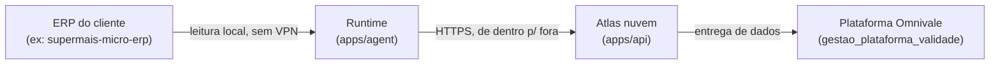
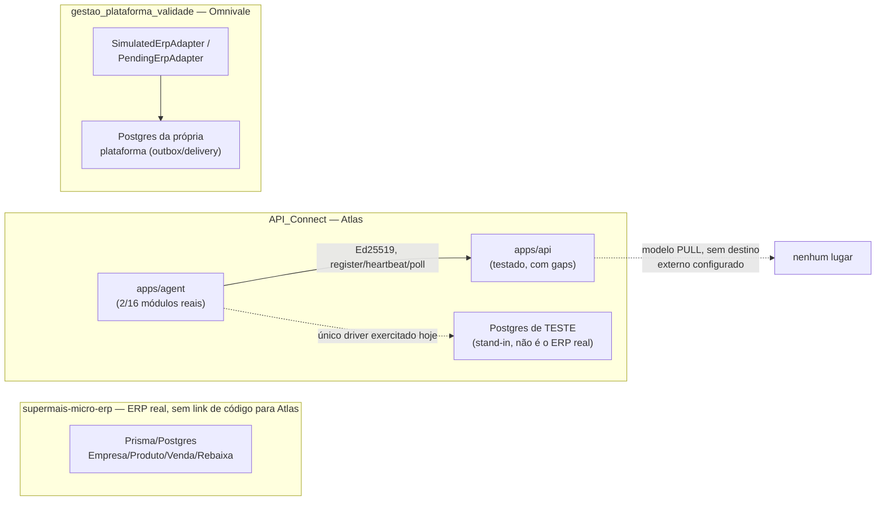

# Auditoria do Atlas — Relatório Final

> Auditoria somente leitura. Nenhum arquivo foi alterado, nenhum commit/push foi feito, nenhuma migration foi executada, e o runtime não foi executado contra nenhum banco ou ERP real. Toda afirmação cita `arquivo:linha`; onde não há evidência no código, está marcado **NÃO CONFIRMADO**. Nenhum valor de segredo é reproduzido neste documento — onde um segredo foi encontrado, consta apenas o arquivo:linha e a frase "segredo encontrado".

**Repositórios inspecionados** (todos em `d:\Projetos\`):

- `API_Connect` — o backend/produto "Atlas" (nuvem + runtime client), pacotes `@seltriva/*`. Alvo principal desta auditoria.
- `gestao_plataforma_validade` — a plataforma de gestão de validade/rebaixas, marca **Omnivale** (nome antigo: **Seltriva**).
- `supermais-micro-erp` — um ERP real em desenvolvimento para a "Rede Super Mais Atacarejo".
- `bio-mapping` — projeto não relacionado (confirmado e ignorado).

---

## Resumo executivo

**O Atlas NÃO está pronto para um piloto real de leitura em um cliente, mesmo em um mercado pequeno.** Os três sistemas que o produto descreve (ERP → Runtime → Atlas nuvem → Omnivale) existem como **três repositórios desconectados entre si no nível de código** — nenhuma linha de código liga um ao outro hoje (Fase 1/2). O runtime local (`apps/agent`) tem só um módulo real e testado (protocolo Ed25519 de registro/heartbeat); os outros 14 de 16 módulos (leitura de ERP além de Postgres de teste, fila offline, agendamento, segurança/criptografia, auto-update, plugins) são apenas interfaces TypeScript sem implementação. Não existe build de executável/instalador real, as credenciais ficam em texto puro no disco do cliente, e a capacidade de **escrita** no banco permanece acessível pelo mesmo driver usado para leitura — nada impede estruturalmente uma violação do requisito "somente leitura". A nuvem Atlas (`apps/api`) é a parte mais madura (testada, com fail-loud de produção), mas tem segredos com fallback hardcoded fora desse processo (`apps/admin`, `apps/web`) e uma fila de mensagens que vive só em memória.

---

## Fase 1 — Onde está cada parte

| Parte                                        | Onde está                                                                                                                                                                                                                                            | Estado                                                                                                                                           |
| -------------------------------------------- | ---------------------------------------------------------------------------------------------------------------------------------------------------------------------------------------------------------------------------------------------------- | ------------------------------------------------------------------------------------------------------------------------------------------------ |
| **(a) Atlas na nuvem**                       | `API_Connect/apps/api` (`@seltriva/api`)                                                                                                                                                                                                             | Real, testado, mas com gaps de segurança (Fase 4/5).                                                                                             |
| **(b) Gerador do runtime**                   | **NÃO CONFIRMADO.** Não existe nenhuma ferramenta de empacotamento de executável (pkg/electron-builder/NSIS/MSI/Inno Setup) em todo `API_Connect`. O único artefato de build é `docker/Dockerfile.agent` (gera imagem Node, não instalador cliente). | Inexistente.                                                                                                                                     |
| **(c) Runtime local**                        | `API_Connect/apps/agent` (`@seltriva/agent`) + `API_Connect/apps/runtime-installer` (`@seltriva/runtime-installer`)                                                                                                                                  | Majoritariamente scaffolding (interfaces sem implementação) — ver Fase 3.                                                                        |
| **(d) Integração com a plataforma Omnivale** | `gestao_plataforma_validade/web/src/services/atlas/*`                                                                                                                                                                                                | 100% simulada internamente (`SimulatedErpAdapter`/`PendingErpAdapter`), sem nenhuma chamada de rede para fora do próprio Postgres da plataforma. |
| **ERP real do cliente**                      | `supermais-micro-erp` (Rede Super Mais Atacarejo)                                                                                                                                                                                                    | Tem schema/domínio real (13 models, 81 testes passando), mas **nenhuma linha de código** liga esse ERP ao Atlas ou à Omnivale.                   |

**Confirmação direta de que os três repositórios não se conectam:**

- Busca por `supermais` em todo `API_Connect`: **0 resultados**.
- `supermais-micro-erp/src/lib/services/rebaixas.ts:304-307` — comentário explícito no próprio ERP: "hoje só o próprio ERP, via `/api/rebaixas`; nenhum adaptador para Atlas/Seltriva foi criado ou é assumido aqui."
- Busca por `API_Connect|seltriva-connect|@seltriva/api|@seltriva/agent` em `gestao_plataforma_validade`: **0 resultados**.
- Busca por `ATLAS_API_URL|ATLAS_CLOUD_URL|SELTRIVA_API_URL|OMNIVALE_API_URL` em `gestao_plataforma_validade`: **0 resultados**; a única env var parecida (`ERP_ADAPTER_BASE_URL`, `web/src/services/atlas/erpRealIntegration.ts:42`) não é usada em nenhuma chamada de rede real em todo o repositório, nem aparece em nenhum `.env*`.
- Busca por `omnivale` em todo `API_Connect/apps/api`: **0 resultados**. O módulo que poderia entregar dados para fora (`message-delivery`) opera em modelo **pull** (o runtime consulta `GET /messages/pending`), não push para nenhum destino externo configurável.
- Documentação da própria Omnivale (`web/docs/46.19-real-erp-sandbox-integration.md:54`) declara: **"Status final: Integração real: `BLOCKED_EXTERNAL_DEPENDENCY`"** — aguardando o fornecedor do ERP entregar documentação de API, sandbox, autenticação, credenciais de teste, contratos e limites de taxa (checklist de 10 itens, todos ❌).

---

## Fase 2 — Arquitetura e fluxo

### Fluxo pretendido pelo produto

### Fluxo real hoje (três ilhas desconectadas)

### Linguagens/frameworks/dependências principais

| Componente                       | Stack                                                                                                        |
| -------------------------------- | ------------------------------------------------------------------------------------------------------------ |
| `apps/api`                       | Node.js/TypeScript, HTTP router próprio (`apps/api/src/http/router.ts`), Prisma/Postgres, Vitest.            |
| `apps/agent`                     | Node.js/TypeScript, `node:crypto` (Ed25519), `@seltriva/database-sdk` (só `PostgresDriver` é usado), Vitest. |
| `apps/runtime-installer`         | Node.js/TypeScript, `sc.exe`/`systemd` para serviço OS.                                                      |
| `gestao_plataforma_validade/web` | Next.js, Prisma/Supabase/Postgres, Vitest.                                                                   |
| `supermais-micro-erp`            | Next.js 16/React 19, Prisma, Supabase.                                                                       |

### Real vs. simulado/mock — por componente

| Componente                                              | Real                                                                     | Simulado/Mock/Inexistente                                                                                                                   |
| ------------------------------------------------------- | ------------------------------------------------------------------------ | ------------------------------------------------------------------------------------------------------------------------------------------- |
| Protocolo de registro/heartbeat runtime↔nuvem (Ed25519) | ✅ Real, testado (`apps/agent/src/atlas-runtime-client/*`, 14/14 testes) | —                                                                                                                                           |
| Leitura de esquema via Postgres                         | ✅ Real (`PostgresDriver.readSchema()`)                                  | Alvo é um **Postgres de teste**, não um ERP real — `apps/agent/src/atlas-runtime-client/executor.ts:1-13` admite isso no próprio comentário |
| Suporte a MySQL/SQLServer/Oracle/Firebird no runtime    | —                                                                        | NÃO CONFIRMADO uso — drivers existem em `packages/database-sdk` mas nunca são importados por `apps/agent`                                   |
| Geração de executável/instalador                        | —                                                                        | Inexistente (Fase 1)                                                                                                                        |
| Agendamento de heartbeat (daemon contínuo)              | —                                                                        | Inexistente — heartbeat dispara 1x por execução manual                                                                                      |
| Fila offline / reenvio                                  | —                                                                        | Inexistente — só interfaces (`apps/agent/src/sync/index.ts`)                                                                                |
| Auto-update                                             | —                                                                        | Inexistente — `version-checker.ts` só compara versões, nunca é chamado pelo resto do instalador                                             |
| Criptografia de credenciais no disco do cliente         | —                                                                        | Inexistente — tudo em JSON texto puro                                                                                                       |
| Nuvem Atlas: recebimento/validação/auth de runtime      | ✅ Real, testado                                                         | Validação de payload é manual, não Zod                                                                                                      |
| Nuvem Atlas: fail-loud de segredos em produção          | ✅ Real, testado com Docker real                                         | Só cobre o processo `apps/api`, não `apps/admin`/`apps/web`                                                                                 |
| Integração Atlas↔Omnivale                               | —                                                                        | 100% simulada dentro da própria Omnivale; zero chamada real                                                                                 |
| Integração Atlas↔ERP real                               | —                                                                        | 100% bloqueada/inexistente, confirmado pelos próprios docs da Omnivale                                                                      |

---

## Fase 3 — Runtime local (`apps/agent` + `apps/runtime-installer`)

**Achado estrutural que condiciona tudo abaixo:** de 16 módulos em `apps/agent/src` (`cache`, `cli`, `configuration`, `connectors`, `diagnostics`, `health`, `logs`, `plugins`, `runtime`, `scheduler`, `security`, `services`, `sync`, `telemetry`, `updates`, e `atlas-runtime-client`), **14 contêm apenas `export interface`/`export type`, sem nenhuma classe implementando.** Os únicos códigos reais são `apps/agent/src/bootstrap/bootstrapper.ts` (`AgentBootstrapperImpl`) e `apps/agent/src/atlas-runtime-client/*`. O pacote de workspace `packages/runtime` (345 exports, 0 classes) nem é importado por `apps/agent`.

1. **Geração/instalação:** Nenhum pipeline gera um executável. `apps/runtime-installer/src/service/windows-service.ts:14-23` registra um serviço Windows (`AtlasRuntime`) via `sc.exe create` apontando para `atlas-runtime.exe`, que **nenhum script do repositório produz**. `linux-service.ts:14-24` cria uma unit systemd com `systemctl enable` (isso sim ligaria ao boot, **se** o binário existisse). `apps/agent/package.json:8` declara `bin: seltriva-agent` apontando para um `cli/bin.ts` que **não existe**.
2. **Acesso ao ERP:** Só `PostgresDriver` de `@seltriva/database-sdk` é usado (`apps/agent/src/atlas-runtime-client/executor.ts:14,25-41`), chamando apenas `readSchema()`. MySQL/SQLServer/Oracle/Firebird existem no pacote mas não são usados pelo agente. NÃO CONFIRMADO leitura via arquivo ou API local.
3. **Somente leitura:** Nenhum call site atual escreve (`executor.ts` só chama `connect`/`readSchema`/`disconnect`). Porém o mesmo `PostgresDriver` importado expõe `.execute()` capaz de rodar `InsertQuery`/`UpdateQuery`/`DeleteQuery` (`packages/database-sdk/src/drivers/postgres.driver.ts:54-67`) — nada no tipo ou no runtime impede isso estruturalmente. Risco estrutural, não violação ativa hoje.
4. **Conexão com a nuvem:** HTTPS, assinatura Ed25519 por requisição (`client.ts`, `protocol.ts:48-50`), com retry/backoff real (`client.ts:59-81`, 3 tentativas). Autenticação de cliente→nuvem real e testada.
5. **Credenciais:** Chave privada Ed25519 e token da nuvem gravados como **JSON em texto puro** — `apps/agent/src/atlas-runtime-client/identity.ts:76-79` e `apps/runtime-installer/src/config/runtime-config.ts:23-43`. `chmod 0600` tentado mas é **no-op no Windows** (`identity.ts:81-83`, comentário admite isso). Nenhum AES/DPAPI/keytar implementado — a interface `security/index.ts:19-23` menciona AES-256-GCM, mas é só texto de interface.
6. **Máquina desligada/sem internet:** NÃO CONFIRMADO — não há fila offline implementada (`apps/agent/src/sync/index.ts` é só interface; `DEFAULT_CONFIG.offline_queue` em `bootstrapper.ts:71-77` é lido por ninguém).
7. **Carga no ERP:** NÃO CONFIRMADO — não há lógica de leitura incremental nem agendamento real para avaliar frequência/impacto.
8. **Monitoramento (heartbeat):** Protocolo real (`client.ts:173-209`, endpoint `POST /runtime/heartbeat`), mas **nunca agendado** — dispara uma única vez por execução manual do CLI (`run.ts:76-82`, chamado 1x em `bootstrapper.ts:601`). `node-cron` está declarado em `package.json:34` mas nunca importado. `bootstrapper.ts:543` admite: "Actual job registration deferred to AgentRuntime startup."
9. **Atualização remota:** NÃO CONFIRMADO — `version-checker.ts:15-34` só compara versões (sem baixar/aplicar) e **não é chamado por nenhum outro arquivo** do instalador (código morto). `UpdateManager` (`updates/index.ts`) é só interface.
10. **Antivírus/assinatura digital:** NÃO CONFIRMADO — nenhuma referência a `signtool`/certificado/code signing encontrada.
11. **Mudança no ERP:** NÃO CONFIRMADO diretamente, mas a introspecção de esquema (`readSchema()`) é genérica via `information_schema`, o que tende a tolerar mudanças de schema melhor do que um mapeamento hardcoded — sem evidência de um mecanismo dedicado de detecção/alerta de breaking change.
12. **Logs:** `apps/agent` não tem logging em arquivo real (só `console.log`; `winston` declarado, nunca importado). `apps/runtime-installer/src/logs/logger.ts:1-86` grava arquivos reais (`installer.log`, `runtime.log`, etc.) com rotação e sanitização **limitada a tokens** (`logger.ts:79-85`) — não há evidência de dados de esquema/ERP sendo logados, nos dois sentidos.

---

## Fase 4 — Atlas na nuvem (`apps/api`)

1. **Endpoints de ingestão:** Dois sistemas paralelos — legado "Atlas Agent" (token opaco `aat_...`, `apps/api/src/middleware/agent-auth.ts:12-44`) e atual "Runtime Registration" (Ed25519 por requisição, `apps/api/src/modules/runtime-registration/signature.ts:15-25`, aplicado em `heartbeat.ts:45-66`). Validação de payload em `register.ts:59-98`/`heartbeat.ts:19-32` é **manual**, não Zod (Zod só é usado nas rotas administrativas do mesmo módulo, `schemas.ts`). Limite de corpo **global** de 1 MB (`router.ts:95`). Rate limit existe em `/runtime/register` (`rate-limiter.ts:1-41`, 10 falhas/15min) mas **NÃO em `/runtime/heartbeat`**.
2. **Isolamento multi-tenant:** Não encontrado caminho cross-org nas rotas de runtime/mensagens atuais — escopo sempre pelo `runtimeId` resolvido da própria assinatura verificada (`message-delivery-store.ts:265-296`, `:206-211`), com teste dedicado passando (`onboarding-isolation.test.ts`). Importante: esse tipo de bug (BOLA) **já ocorreu e foi corrigido** em rotas de portal (`apps/api/src/http/tenant.ts:16-28`, `routes/v1/portal/dashboard.ts:13-22`) — não nas rotas de runtime, mas mostra que o padrão de risco é real nesse código-base.
3. **Armazenamento:** Registro do runtime em Postgres/Prisma (`runtime-registration.repository.ts`), sem TTL, sobrescrito a cada heartbeat (sem histórico). **Fila de mensagens runtime↔nuvem é só em memória** (`message-delivery-store.ts:36-39`) — perdida em qualquer restart do processo; TTL de 24h para dead-letter (`retry-policy.ts:3`).
4. **Entrega para Omnivale:** NÃO CONFIRMADO — zero referência a "omnivale" em `apps/api`; nenhum endpoint `/ingest`; o módulo `message-delivery` é **pull** (runtime consulta `/messages/pending`), não push para fora.
5. **Segredos/fallbacks:** Segredo encontrado (fallback hardcoded, sem reprodução de valor) em: `apps/api/src/modules/runtime-registration/runtime-jwt.ts:5`, `certificate.ts:5`, `apps/api/src/modules/message-delivery/message-signature.ts:4`, `apps/api/src/modules/admin-identity/jwt.ts:6`, `apps/api/src/modules/portal-identity/jwt.ts:6`, `apps/api/src/modules/connectors/package-integrity.ts:4`, `apps/api/src/modules/admin-identity/admin-identity-store.ts:26`, `apps/api/src/middleware/auth.ts:10` (fallback para string vazia).
6. **Validação de boot:** Real e testada com Docker real — `apps/api/src/services/production-secrets.ts:11-47` (`assertProductionSecretsConfigured`), chamada em `index.ts:16-19`; teste `apps/api/src/__tests__/health/production-fail-loud.test.ts:92-213`.

---

## Fase 5 — Segurança e LGPD

1. **Segredos no código (lista completa, arquivo:linha, "segredo encontrado" sem reprodução de valor):**
   - `apps/api/src/modules/admin-identity/jwt.ts:6`, `apps/api/src/modules/portal-identity/jwt.ts:6`, `apps/api/src/modules/runtime-registration/runtime-jwt.ts:5`, `apps/api/src/modules/runtime-registration/certificate.ts:5`, `apps/api/src/modules/connectors/package-integrity.ts:4`, `apps/api/src/modules/message-delivery/message-signature.ts:4`, `apps/api/src/middleware/auth.ts:10` (fallback vazio).
   - **Fora de `apps/api`, sem o mesmo fail-loud:** `apps/admin/src/middleware.ts:6` (`ADMIN_JWT_SECRET`, mesmo valor do item acima), `apps/web/middleware.ts:6` e `apps/web/src/app/api/hub/login/route.ts:6` (`HUB_JWT_SECRET`, não está nem na lista de `REQUIRED_IN_PRODUCTION`).
   - `.claude/settings.local.json:8` — segredo encontrado (connection string com credencial). Recomenda-se confirmar manualmente se este arquivo está no `.gitignore`.
   - `.env`/`apps/api/.env` também contêm a connection string de desenvolvimento, mas **não estão versionados** (confirmado via `git ls-files`) — comportamento esperado, sem achado crítico aí.
2. **PII:** O schema próprio da plataforma (`packages/database/prisma/schema.prisma`) não tem campos de cliente final (CPF/telefone/fiado) — guarda só PII de usuários/admins da própria plataforma (`schema.prisma:582-584` `User.email/displayName/avatarUrl`; `:230-231` `AtlasAdminUser.name/email`; `:254-255` `AtlasAdminSession.ip/userAgent`). Porém o "vocabulário canônico" usado para mapear ERPs de clientes define tipos explícitos de PII em trânsito — `apps/api/src/modules/query-planner/canonical-vocabulary.ts:146-160` (`PHONE`, `EMAIL`, `TAX_ID`/CPF-CNPJ, endereço). Isso caracteriza a Atlas como operadora de dados (LGPD art. 5º VII) para esses fluxos, mesmo sem persistir essa PII no próprio banco.
3. **Leak de erros:** Nenhum confirmado. `apps/api/src/server.ts:121-156` (`withErrorBoundary`) loga stack só internamente e retorna mensagens genéricas ao cliente; `router.ts:317-324` (`apiError`) nunca inclui stack. Observação relacionada (não é leak de erro, é controle de ambiente): `apps/api/src/middleware/auth.ts:204,222` tem bypass de auth só sob `NODE_ENV==='development'` — depende de configuração correta de ambiente em todo deploy.
4. **Vulnerabilidades (`pnpm audit`, raiz do monorepo):** 2 critical, 13 high, 13 moderate, 1 low (29 total). Critical é `vitest` (devDependency, CVE-2026-47429, risco só em dev/CI). Os únicos high/critical em **dependências de produção real** são `axios` (`apps/agent/package.json:36`, 6 CVEs high — SSRF, ReDoS, prototype pollution) e `node-forge` (`apps/agent/package.json:44`, CVE-2026-85393, bypass de assinatura RSA, sem patch disponível). **Cruzamento importante com a Fase 6:** ambos são declarados mas **nunca importados** em `apps/agent/src` — são dependências mortas carregando vulnerabilidade sem benefício funcional algum.

---

## Fase 6 — Qualidade

1. **Testes:** `apps/agent/src` tem 3 arquivos de teste (14/14 passam, unitários puros, `pnpm --filter @seltriva/agent test`). `apps/api/src` tem 92 arquivos de teste — a suíte completa não foi executada por este agente (não é necessário infraestrutura real para a maioria; um subconjunto pequeno de arquivos de saúde/Docker exige Postgres real e foi corretamente evitado).
2. **Tratamento de erros:** Nenhum `catch` totalmente vazio, mas vários suprimem o erro sem log (`apps/agent/src/bootstrap/bootstrapper.ts:161-163,217-219,295-297,351-353`; `identity.ts:82-84,87-89`). Em `packages/connectors`/`connector-sdk` o tratamento é consistente (sempre re-lança ou envelopa).
3. **Falta de retry:** O protocolo principal (`client.ts`) tem retry com backoff real. Um caminho paralelo e mais antigo não tem: `bootstrapper.ts:656-673` (`_registerWithCloud`) falha sem retry (só timeout de 10s).
4. **Código morto/inacabado:** `cli/bin.ts` ausente (binário publicado quebrado); `version-checker.ts` nunca chamado; dependências declaradas e nunca usadas (`@seltriva/runtime`, `@seltriva/core`, `@seltriva/types`, `axios`, `p-retry`, `yaml`, `node-cron`, `node-forge`, `winston`); `apps/api/src/modules/erp-integration/erp-integration-health.ts:27` é placeholder explícito (`NOT_IMPLEMENTED`); TODO desatualizado em `apps/api/src/middleware/auth.ts:203`.

---

## Riscos priorizados

| Severidade  | Achado                                                                                                                                                                     | Evidência                                                                                                                    | Correção sugerida                                                                                                         |
| ----------- | -------------------------------------------------------------------------------------------------------------------------------------------------------------------------- | ---------------------------------------------------------------------------------------------------------------------------- | ------------------------------------------------------------------------------------------------------------------------- |
| **Crítico** | Credenciais do runtime (chave privada Ed25519, token da nuvem) em texto puro no disco do cliente                                                                           | `apps/agent/src/atlas-runtime-client/identity.ts:76-79`; `apps/runtime-installer/src/config/runtime-config.ts:23-43`         | Implementar criptografia real (DPAPI no Windows, keytar/libsecret no Linux) antes de qualquer piloto.                     |
| **Crítico** | Nenhum build/empacotamento de executável — instalador aponta para binário inexistente                                                                                      | `apps/runtime-installer/src/service/windows-service.ts:14`                                                                   | Decidir estratégia de empacotamento (serviço Node simples vs. executável nativo) e construir/testar de ponta a ponta.     |
| **Crítico** | Capacidade de escrita (`InsertQuery`/`UpdateQuery`/`DeleteQuery`, `.execute()`) acessível pelo mesmo driver usado para ler o ERP — nada impede estruturalmente uma escrita | `packages/database-sdk/src/drivers/postgres.driver.ts:54-67`; usado por `apps/agent/src/atlas-runtime-client/executor.ts:14` | Introduzir um driver/wrapper estritamente somente-leitura para o caminho do agente, sem expor `.execute()` de escrita.    |
| **Crítico** | Segredos JWT/assinatura com fallback hardcoded, sem fail-loud equivalente fora de `apps/api`                                                                               | `apps/admin/src/middleware.ts:6`; `apps/web/middleware.ts:6`; `apps/web/src/app/api/hub/login/route.ts:6`                    | Estender `assertProductionSecretsConfigured` (ou equivalente) para `apps/admin` e `apps/web`.                             |
| **Alto**    | Heartbeat nunca agendado — só dispara 1x por execução manual                                                                                                               | `apps/agent/src/bootstrap/bootstrapper.ts:543`; `node-cron` nunca importado                                                  | Implementar agendamento real (cron/setInterval) dentro de um processo de longa duração.                                   |
| **Alto**    | Fila offline/reenvio inexistente — dado é perdido se a nuvem estiver inacessível                                                                                           | `apps/agent/src/sync/index.ts` (só interface)                                                                                | Implementar fila persistida (SQLite) com idempotência antes do piloto.                                                    |
| **Alto**    | Fila de mensagens runtime↔nuvem só em memória na API                                                                                                                       | `apps/api/src/modules/message-delivery/message-delivery-store.ts:36-39`                                                      | Persistir em Postgres ou fila dedicada (Redis/SQS) com at-least-once garantido.                                           |
| **Alto**    | Sem rate limit em `/runtime/heartbeat`                                                                                                                                     | `apps/api/src/routes/v1/runtime-registration/heartbeat.ts`                                                                   | Aplicar o mesmo limitador já existente em `register.ts`.                                                                  |
| **Alto**    | Dependências de produção vulneráveis em `apps/agent` (axios, node-forge) — porém não utilizadas no código                                                                  | `apps/agent/package.json:36,44`; confirmado sem import em `apps/agent/src`                                                   | Remover as dependências não usadas (elimina o risco sem custo funcional).                                                 |
| **Médio**   | Nenhum code signing do executável/instalador                                                                                                                               | Busca repo-wide sem resultado                                                                                                | Assinar digitalmente antes de distribuir a clientes.                                                                      |
| **Médio**   | Auto-update inexistente/desconectado                                                                                                                                       | `apps/runtime-installer/src/updates/version-checker.ts` (não chamado)                                                        | Implementar fluxo completo com verificação de assinatura antes do piloto, se a operação depender de atualização remota.   |
| **Médio**   | Validação manual (não Zod) em `register`/`heartbeat`                                                                                                                       | `apps/api/src/routes/v1/runtime-registration/register.ts:59-98`, `heartbeat.ts:19-32`                                        | Migrar para os mesmos schemas Zod já usados nas rotas admin do módulo.                                                    |
| **Médio**   | 14/16 módulos do runtime são só interfaces sem implementação                                                                                                               | `apps/agent/src/{sync,connectors,scheduler,security,plugins,updates,cache,logs,...}/index.ts`                                | Priorizar implementação real dos módulos necessários ao piloto (ao menos: security/credenciais, sync/offline, scheduler). |
| **Baixo**   | Segredo encontrado em `.claude/settings.local.json:8`                                                                                                                      | `.claude/settings.local.json:8`                                                                                              | Confirmar manualmente que está no `.gitignore`; se não estiver, remover do versionamento.                                 |
| **Baixo**   | Dependências declaradas e nunca usadas                                                                                                                                     | `apps/agent/package.json` (`@seltriva/runtime`, `@seltriva/core`, `@seltriva/types`, `p-retry`, `yaml`, `winston`)           | Limpeza de dependências.                                                                                                  |

---

## O mínimo para o primeiro piloto

1. Decidir e construir um empacotamento real do runtime (executável assinado ou serviço Node documentado) — hoje é literalmente impossível instalar no cliente como descrito.
2. Criptografar credenciais em disco (chave privada do runtime + token da nuvem).
3. Implementar e testar a leitura de pelo menos um ERP real (candidato natural: `supermais-micro-erp`, que já tem schema/dados reais) — hoje só um Postgres de teste genérico é exercitado.
4. Bloquear estruturalmente a capacidade de escrita no caminho do agente (driver somente-leitura dedicado).
5. Implementar agendamento real de heartbeat e um processo de longa duração.
6. Implementar fila offline persistida com idempotência.
7. Estender o fail-loud de segredos de produção para `apps/admin` e `apps/web`.
8. Definir e construir o caminho real de entrega Atlas→Omnivale (hoje inexistente) — ou redefinir o escopo do piloto para não depender disso.
9. Resolver (ou contornar) o bloqueio `BLOCKED_EXTERNAL_DEPENDENCY` da integração ERP real na Omnivale, documentado pela própria plataforma.

## Pode esperar

- Auto-update completo com rollback.
- Suporte a MySQL/SQLServer/Oracle/Firebird no runtime (hoje só Postgres é exercitado).
- Implementação completa de todos os módulos de interface do agente não essenciais ao piloto (telemetry, plugins, cache sofisticado).
- Rotação/retenção avançada de logs.
- Remoção de dependências mortas (cosmético).

## Perguntas em aberto (não confirmável só lendo código)

- Qual ERP real será o alvo do primeiro piloto — `supermais-micro-erp` parece o candidato natural, mas não há nenhuma decisão registrada em código.
- Quando (ou se) o fornecedor do ERP vai entregar a documentação que a Omnivale está esperando — é um bloqueio externo, não técnico, segundo os próprios docs da plataforma.
- Existe algum plano de empacotamento/distribuição do runtime fora deste monorepo que não foi encontrado na auditoria?
- `.claude/settings.local.json:8` contém um segredo — precisa de confirmação humana sobre `.gitignore`/exposição em algum histórico de commit, o que está fora do alcance de uma leitura estática do estado atual.
- Há um plano de produto para múltiplos conectores/ERPs (o wizard do instalador aceita um `connectorType` livre, default `"generic"`) que não está refletido em nenhuma implementação de conector real além de Postgres?
